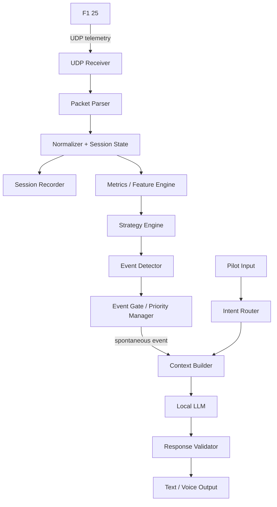
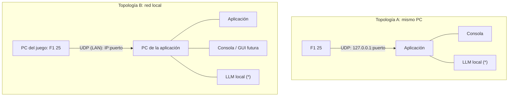
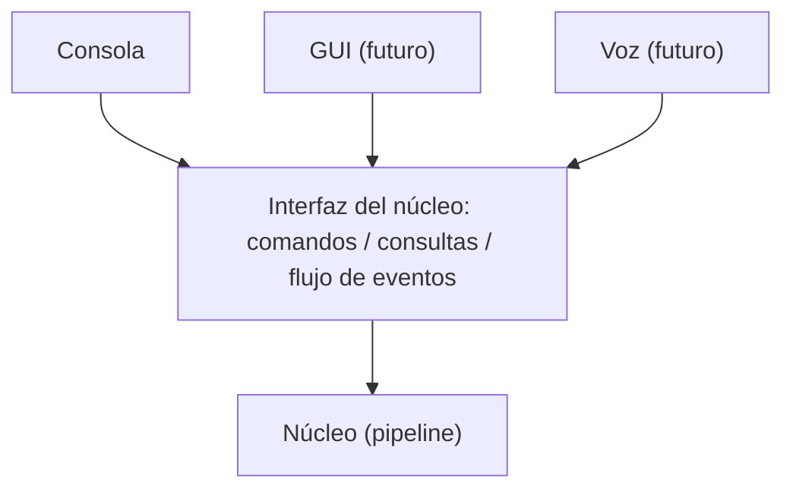
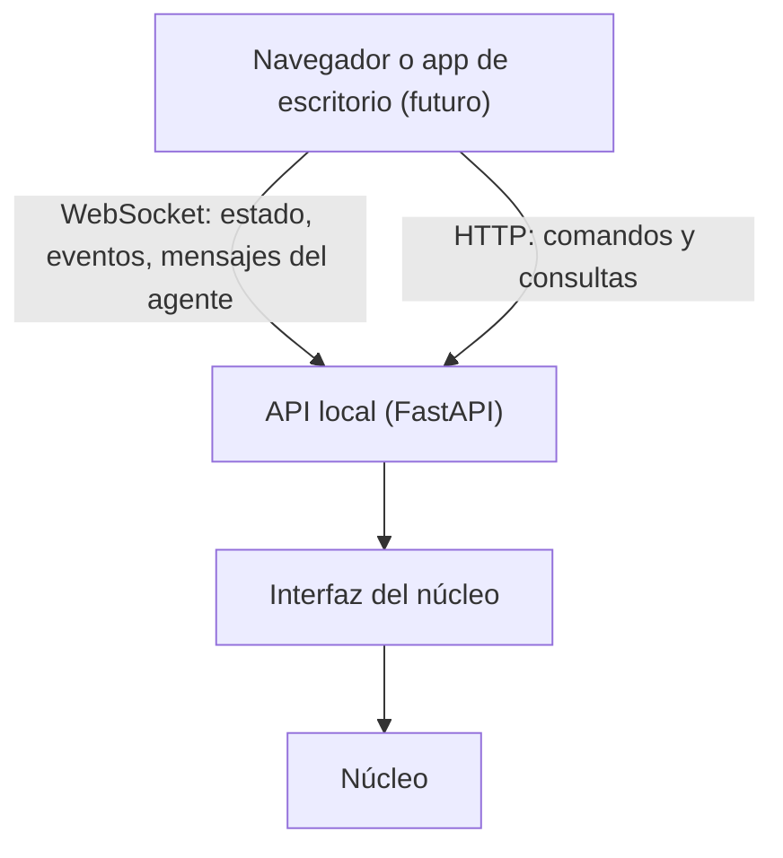

# Outline técnico --- Ingeniero de carrera IA local para F1 25

## 1. Visión general

Aplicación local orientada a eventos que transforma telemetría UDP de F1
25 en un estado de carrera, métricas derivadas y recomendaciones
estratégicas. Un gestor de eventos decide cuándo comunicar; el LLM local
interpreta el contexto y redacta la respuesta. Las preguntas del piloto
utilizan una ruta de consulta independiente.

La aplicación puede ejecutarse en el mismo PC donde corre el juego o en
otro PC de la red local (sección 2.1). La primera interfaz es la consola;
el núcleo se diseña independiente de la presentación para añadir después
una GUI (sección 2.2) y localización a inglés y español (componente
3.13).

### Principio arquitectónico

**El código mantiene el estado, calcula y decide cuándo consultar al
modelo. El LLM razona sobre el contexto seleccionado y se comunica.**

No se debe enviar cada batch al LLM ni depender de él para cálculos que
puedan verificarse mediante código.

## 2. Diagrama lógico



La recepción, normalización y registro deben continuar aunque el LLM
esté ocupado o no disponible.

### 2.1 Topologías de despliegue

El mismo artefacto soporta dos topologías. La diferencia es solo de
configuración.



(*) El endpoint del LLM es configurable y puede estar en cualquiera de
los dos PC o en otra máquina de la red local.

Configuración ilustrativa (los nombres finales se definirán en la
implementación; el puerto debe coincidir con el configurado en el juego):

``` yaml
telemetry:
  listen_address: "127.0.0.1"   # "0.0.0.0" o IP de la interfaz LAN para
                                # recibir desde otro PC
  listen_port: 20777
  allowed_sources: []           # opcional, por ejemplo ["192.168.1.20"]
llm:
  endpoint: "http://127.0.0.1:1234/v1"   # puede apuntar a otro PC
```

Notas:

-   En topología B, el juego debe enviar la telemetría a la IP del PC de
    la aplicación (envío dirigido). El broadcast es opcional y expone los
    datos a cualquier equipo de la red.
-   El PC de la aplicación necesita una regla de firewall que permita el
    puerto UDP de entrada.
-   La recepción se sella con el reloj del PC de la aplicación; el orden
    de los datos se apoya en el tiempo de sesión del juego y no en
    relojes sincronizados entre PCs.
-   En topología A, la aplicación y el LLM compiten con el juego por
    CPU/GPU. Debe medirse el impacto y, si es necesario, mover el LLM a
    otra máquina.
-   Por defecto la aplicación solo escucha en loopback. Abrirla a la red
    local es una decisión explícita del usuario.

### 2.2 Núcleo e interfaces

El núcleo (receptor, parser, estado, métricas, estrategia, eventos, gate,
router de intenciones, contexto y LLM) no conoce ninguna interfaz
concreta. Las interfaces son adaptadores que se conectan a una interfaz
estable del núcleo.



-   **Comandos:** enviar una pregunta del piloto, silenciar o reactivar
    al agente, cambiar configuración, iniciar o detener un replay.
-   **Consultas:** estado de conexión, estado de carrera, estrategia
    actual, histórico reciente.
-   **Flujo de salida:** mensajes del agente (estructurados),
    eventos, cambios de estado de conexión y errores.

La interfaz del núcleo debe ser la misma para la consola y la futura GUI.
La consola arranca como adaptador en proceso sobre esa interfaz; la GUI
la usa a través de una API local (sección 2.3). Si la GUI se ejecuta en un
PC distinto al del núcleo, la API se expone por red de forma explícita y
con token de acceso.

### 2.3 API local y contrato con la GUI

Ruta acordada para la GUI: una interfaz web local conectada al núcleo
por una API local. La consola no necesita el servidor; la API se añade
cuando llegue la GUI.



Reglas del contrato:

-   **Esquema versionado.** Los mensajes se definen con modelos
    `pydantic`, se exportan como JSON Schema y los tipos de TypeScript de
    la GUI se generan desde ese esquema. La versión del contrato se
    comprueba al conectar y una incompatibilidad se informa de forma
    explícita.
-   **Snapshot más cambios.** Al conectarse o reconectarse, la GUI
    recibe el estado completo y después cambios incrementales con número
    de secuencia (`seq`). Si detecta un hueco, pide un snapshot nuevo.
-   **Frecuencia limitada.** El estado resumido se envía a un máximo de
    10 a 20 Hz. Los eventos y mensajes del agente se envían al
    producirse. Si un cliente es lento, se descartan estados
    intermedios, nunca eventos ni mensajes.
-   **Sin lógica en la GUI.** Toda decisión y cálculo vive en el núcleo.
    La GUI presenta y envía comandos.
-   **Seguridad.** La API escucha en loopback por defecto. Abrirla a la
    red local requiere activación explícita y un token de acceso.
-   **Desacople.** Abrir, cerrar o reiniciar la GUI no afecta a la
    captura, el registro ni el agente.

Ejemplo ilustrativo de mensaje (los campos finales se definirán en la
implementación):

``` json
{
  "v": 1,
  "type": "state_delta",
  "seq": 1042,
  "session_time_s": 1832.4,
  "data": {
    "player": { "fuel_margin_laps": 0.8, "tyre_age_laps": 12 }
  }
}
```

## 3. Componentes

### 3.1 UDP Receiver

Responsabilidades:

-   Abrir el socket UDP en la dirección y el puerto configurados
    (loopback por defecto, interfaz LAN o `0.0.0.0` si se configura).
-   Recibir datagramas sin bloquear el resto de la aplicación.
-   Añadir timestamp de recepción con el reloj local.
-   Registrar la IP de origen y aplicar el filtro de orígenes permitidos
    cuando esté configurado.
-   Contabilizar paquetes recibidos, inválidos, descartados y de origen
    no permitido.
-   Detectar periodos sin datos y exponer causas probables para el
    diagnóstico (por ejemplo, ningún paquete desde el arranque, puerto
    ocupado o solo paquetes de un origen no permitido).
-   Informar de fallos al abrir el socket (puerto ocupado, interfaz
    inexistente) con un mensaje claro.

No debe contener lógica estratégica ni prompts.

### 3.2 Packet Parser

Responsabilidades: - Decodificar los paquetes de acuerdo con la
especificación de telemetría de F1 25. - Validar longitud, versión,
identificadores y rangos. - Convertir estructuras binarias a objetos
tipados. - Separar los tipos de paquete y sus datos. - Gestionar
paquetes desconocidos de forma segura.

Conviene aislar el parser detrás de una interfaz para poder actualizar
el protocolo sin modificar el resto del sistema.

### 3.3 Normalizer y Session State

Mantiene una representación unificada de: - Sesión: tipo, duración,
vuelta actual, vueltas restantes y condiciones. - Coche del usuario:
velocidad, combustible, neumáticos, ERS, daños y estado relevante. -
Rivales: identificadores, posiciones, intervalos y datos disponibles. -
Carrera: banderas, safety car, clima y otros estados. - Calidad de
datos: timestamp, antigüedad y disponibilidad de cada campo.

Mantener dos tipos de información: 1. **Estado instantáneo:** último
valor válido. 2. **Histórico:** muestras, agregados por sector/vuelta y
tendencias.

El estado debe distinguir `unknown`, `stale` y valores válidos. No
asumir que un dato ausente equivale a cero.

### 3.4 Metrics / Feature Engine

Transforma telemetría de bajo nivel en variables útiles para la
estrategia.

Ejemplos: - Consumo medio y variabilidad de combustible por vuelta. -
Margen proyectado de combustible al final. - Desgaste y edad de
neumáticos. - Ritmo limpio estimado y tendencia de degradación. -
Diferencia con rivales y cambio de intervalo. - Tiempo de parada
estimado. - Estado de ERS y oportunidades de uso. - Tendencia de daños o
pérdida de rendimiento.

Cada métrica debería tener: - Valor y unidad. - Ventana de cálculo. -
Timestamp. - Calidad o confianza. - Datos de entrada relevantes.

Evitar comparar vueltas que no sean comparables sin marcar factores como
tráfico, compuesto, edad del neumático o condiciones cambiantes.

### 3.5 Strategy Engine

Responsabilidad: comparar planes posibles y devolver resultados
estructurados.

Primera versión: - Plan actual. - Parar ahora. - Parar dentro de N
vueltas. - Mantenerse fuera bajo el plan actual.

Modelo conceptual:

``` text
estimated_total_time(plan) =
    projected_lap_times
  + pit_stop_losses
  + traffic_and_rejoin_costs
  + other_modelled_costs
```

La implementación real debe evitar contar dos veces los mismos costes y
documentar los supuestos.

Salida sugerida:

``` json
{
  "current_plan": "medium-hard",
  "recommendation": {
    "action": "PIT_NOW",
    "estimated_gain_seconds": 2.4,
    "confidence": 0.78
  },
  "alternatives": [
    {
      "action": "PIT_NOW",
      "estimated_total_time": 1234.5
    },
    {
      "action": "PIT_IN_2_LAPS",
      "estimated_total_time": 1236.9
    }
  ],
  "assumptions": [
    "No se espera lluvia durante el horizonte simulado"
  ],
  "risks": [
    "Tráfico al reincorporarse"
  ],
  "data_quality": "usable"
}
```

Los valores son ilustrativos. La salida real debe basarse en cálculos
propios.

El motor debe poder responder `NO_CHANGE` o `INSUFFICIENT_DATA`, no
forzar siempre una acción.

### 3.6 Event Detector

Evalúa métricas y estado para detectar: - Ventana de parada. - Ventaja
material de una estrategia alternativa. - Degradación anormal. -
Combustible proyectado insuficiente. - Cambio meteorológico. - Safety
car o bandera relevante. - Daño o pérdida de rendimiento. - Cambios
relevantes en la situación de un rival.

Usar: - Umbrales configurables. - Persistencia para filtrar
fluctuaciones. - Histéresis para evitar oscilaciones. - Identificadores
de evento para deduplicación. - Condiciones de cierre cuando el evento
deja de estar activo.

### 3.7 Event Gate / Priority Manager

Es la barrera que decide si una situación merece una llamada al LLM y
una posible interrupción al piloto.

Prioridades iniciales: - **Critical:** puede interrumpir y saltarse el
cooldown. - **Strategic:** requiere una decisión o acción útil; respeta
reglas de frecuencia. - **Informational:** se comunica solo si aporta
valor y hay espacio para hacerlo. - **No-op:** no genera llamada al LLM.

Controles: - Cooldown global y/o por categoría. - Deduplicación por
`event_id`. - Umbral mínimo de beneficio estratégico. - Persistencia del
evento. - Supresión de mensajes equivalentes. - Cancelación o
actualización de eventos obsoletos.

La ausencia de evento debe finalizar el flujo sin llamar al LLM.

### 3.8 Pilot Input e Intent Router

Entrada inicial: texto desde la consola, a través de la interfaz del
núcleo (sección 2.2). La voz y la GUI pueden añadirse después sin
cambiar el router. El router debe diseñarse para reconocer preguntas en
más de un idioma (inglés y español como mínimo, ver 3.13).

El router identifica intenciones como: - `COMPARE_DRIVER` -
`ASK_STRATEGY` - `FUEL_STATUS` - `TYRE_LIFE` - `PACE_DIAGNOSIS` -
`PIT_UNDERCUT` - `GENERAL_RACE_STATE`

Después llama a funciones internas específicas. Ejemplos:

``` text
get_race_state()
compare_driver(driver_id)
estimate_fuel_margin()
estimate_tyre_life()
get_recent_pace_trend()
simulate_strategy(options)
```

La consulta explícita del piloto tiene prioridad sobre el cooldown de
mensajes espontáneos.

### 3.9 Context Builder

Construye un contexto compacto según la tarea.

Para un evento: - Tipo y prioridad del evento. - Qué cambió. - Métricas
relevantes. - Recomendación y alternativas del motor. - Incertidumbres y
datos faltantes. - Mensajes recientes relevantes.

Para una pregunta: - Intención detectada. - Resultado de la función
consultada. - Estado de carrera mínimo necesario. - Restricciones de
respuesta.

No incluir telemetría cruda irrelevante ni todo el histórico. El
histórico reside en el estado/almacenamiento y se consulta bajo demanda.

El contexto incluye el idioma de comunicación configurado (`language`)
y el glosario correspondiente. Los datos y las claves de evento se
envían sin traducir; solo el texto final depende del idioma.

### 3.10 Local LLM y Response Validator

El LLM: - Explica recomendaciones. - Resume la situación. - Responde en
lenguaje natural. - Convierte datos estructurados en mensajes breves de
radio. - Puede señalar contradicciones o información faltante.

No debe: - Inventar cifras. - Modificar resultados numéricos del
motor. - afirmar que una estimación es certeza. - emitir órdenes si los
datos necesarios son obsoletos o insuficientes.

Se recomienda una salida estructurada antes de generar voz:

``` json
{
  "should_speak": true,
  "priority": "strategic",
  "language": "en",
  "message": "Box this lap. We estimate a 2.4-second gain.",
  "reason": "The current tyre degradation makes the alternative faster.",
  "used_facts": [
    "estimated_gain_seconds"
  ]
}
```

El validador comprueba el esquema, los hechos utilizados, la longitud, el idioma
y la prioridad. El Event Gate sigue siendo la autoridad principal sobre si
llamar al modelo.

El idioma del mensaje de ejemplo es ilustrativo. El idioma real lo
determina la configuración (3.13).

### 3.11 Session Recorder y Replay

Guardar: - Paquetes o datos normalizados, según el volumen elegido. -
Estado y métricas derivadas. - Eventos detectados y decisiones del Event
Gate. - Entradas del piloto. - Contexto enviado al modelo. - Respuestas
y latencias. - Versiones de configuración, reglas y modelo.

El replay permite probar cambios de reglas y modelos con la misma
carrera sin tener que conducir nuevamente.

El replay debe ofrecer dos modos:

1.  **Interno:** alimenta el pipeline directamente desde la grabación.
2.  **Reemisión UDP:** reenvía los paquetes grabados por UDP a una
    dirección y puerto configurables. Permite probar el receptor real y
    ambas topologías de despliegue (incluida la red local) sin abrir el
    juego.

Los registros usan códigos e identificadores neutros al idioma (tipos de
evento, claves de mensaje, enums). El texto localizado se guarda como
dato adicional, no como la única representación, para poder reproducir
una sesión en cualquier idioma.

### 3.12 Interfaces de usuario (Presentation Adapters)

Responsabilidades:

-   Presentar al piloto el estado de conexión, los avisos del agente y
    las respuestas, y recoger sus preguntas.
-   Traducir las acciones del usuario a comandos de la interfaz del
    núcleo (2.2).
-   No contener lógica de estrategia, eventos ni acceso directo a
    telemetría.

**Consola (primera interfaz).** Incluye como mínimo:

-   Estado de conexión UDP: dirección/puerto, IP de origen, antigüedad
    de la última muestra y contadores.
-   Resumen de sesión: vuelta, posición, combustible, neumáticos.
-   Registro de avisos y respuestas del agente.
-   Prompt de entrada para preguntas del piloto.
-   Estado del LLM y control para silenciar al agente sin detener la
    captura.

**GUI (futura).** Interfaz web local que consume la API del núcleo (2.3).
Debe poder añadirse sin modificar el pipeline. La ruta prevista tiene tres
pasos, cada uno reutiliza el anterior:

1.  **Dashboard mínimo** sobre la API local: estado de conexión, carrera,
    eventos, estrategia, avisos y entrada de preguntas.
2.  **Pulido visual y diseño para carrera:** pocos datos grandes y
    legibles durante la conducción; paneles detallados para antes y
    después de la sesión.
3.  **Empaquetado de escritorio (opcional):** Tauri o Electron con el
    núcleo como proceso auxiliar.

Notas de diseño:

-   Durante la conducción casi no se mira un panel complejo. La voz sigue
    siendo el canal principal.
-   Una segunda pantalla o una tablet en la red local es la opción
    preferida para la GUI en carrera.
-   Un overlay sobre el juego solo es viable si el juego corre en
    ventana sin bordes. No se inyectará nada en el proceso del juego.

Si la aplicación se ejecuta en un PC distinto al del juego, la
interfaz del piloto vive en ese PC. Para uso durante la conducción se
recomienda priorizar salida de voz o una segunda pantalla.

### 3.13 Localización (i18n)

Alcance futuro (inglés y español como mínimo). Se prepara desde el
principio con estas piezas:

-   **Catálogos de mensajes** por idioma con idioma de respaldo. Todo
    texto visible usa una clave (`message_key`) más parámetros.
-   **Registro de prompts** versionado por idioma.
-   **Glosario** de terminología de carrera por idioma.
-   **Formateador** de números, unidades y decimales en la capa de
    presentación.
-   **Router de intenciones** con soporte para preguntas en ambos
    idiomas.
-   **Validador de respuestas** que comprueba el idioma esperado.

Reglas:

-   Idioma de interfaz, idioma de comunicación del agente, idioma de
    entrada y idioma de voz son configuraciones independientes.
-   Los eventos, métricas y registros no dependen del idioma.
-   Las cifras de una respuesta deben ser idénticas en todos los idiomas
    para el mismo evento.

## 4. Flujos principales

### 4.1 Flujo de telemetría

1.  Recibir datagrama.
2.  Parsear y validar.
3.  Normalizar y actualizar el estado.
4.  Actualizar históricos y métricas.
5.  Ejecutar el motor de estrategia cuando corresponda.
6.  Detectar eventos.
7.  Pasar eventos por Event Gate.
8.  Si no hay evento comunicable, terminar sin invocar al LLM.
9.  Si hay evento, construir contexto, generar y validar mensaje.
10. Enviar la salida a la interfaz activa y registrar el resultado.

### 4.2 Flujo de pregunta del piloto

1.  Recibir la pregunta.
2.  Identificar intención y entidades (por ejemplo, piloto rival).
3.  Consultar estado o ejecutar la función necesaria.
4.  Construir contexto con resultados verificables.
5.  Generar respuesta.
6.  Validar cifras y formato.
7.  Entregar respuesta y registrar la interacción.

Este flujo no debe ser bloqueado por el cooldown de alertas espontáneas.

## 5. Contratos de datos sugeridos

Separar modelos internos de los formatos de paquetes UDP.

Entidades principales: - `TelemetryPacket` - `SessionState` -
`CarState` - `OpponentState` - `LapMetrics` - `StrategyPlan` -
`StrategyEvaluation` - `RaceEvent` - `PilotQuery` - `AgentResponse`

Cada objeto debería incluir identificadores y timestamps cuando aplique.

Entidades adicionales sugeridas: `ConnectionStatus` (dirección, puerto,
IP de origen, antigüedad y contadores), `LocaleConfig` (idiomas de
interfaz, comunicación, entrada y voz) y `MessageKey` (clave de mensaje
localizable con sus parámetros).

`AgentResponse` debe llevar el código o la clave del mensaje, los
parámetros, el idioma y el texto renderizado. Los formatos internos no
dependen del idioma.

Los modelos que cruzan la API local (snapshot, cambios, mensajes del
agente, comandos) se definen con `pydantic`, llevan versión de contrato y
se exportan como JSON Schema (sección 2.3).

### Ejemplo de snapshot estratégico

``` json
{
  "session": {
    "lap": 24,
    "laps_remaining": 18,
    "safety_car": false
  },
  "player": {
    "position": 4,
    "tyre_compound": "medium",
    "tyre_age_laps": 12,
    "fuel_margin_laps": 0.8,
    "pace_trend": "degrading"
  },
  "opponent": {
    "name": "Hamilton",
    "gap_seconds": 1.8,
    "gap_trend": "closing"
  },
  "strategy": {
    "current_plan": "medium-hard",
    "best_alternative": "pit_now",
    "estimated_gain_seconds": 2.4,
    "confidence": 0.78
  },
  "trigger": {
    "type": "strategy_change",
    "reason": "material_advantage"
  }
}
```

Ejemplo ilustrativo; los campos finales dependerán de los paquetes y
métricas implementados.

## 6. Consideraciones de rendimiento y concurrencia

-   El loop de UDP debe ser ligero y no esperar al LLM.
-   Las llamadas al modelo deben ejecutarse en un worker/tarea
    independiente.
-   Mantener una cola acotada para evitar acumular mensajes obsoletos.
-   Si llega un evento nuevo mientras se genera una respuesta, definir
    si reemplaza, cancela o espera a la anterior según prioridad.
-   Las preguntas del piloto deben tener una ruta prioritaria.
-   Medir latencia desde la recepción del dato relevante hasta la salida
    de voz/texto.
-   Evitar ejecutar simulaciones costosas en cada paquete; ejecutarlas
    al cambiar métricas relevantes o a intervalos adecuados.
-   En topología de red local, esperar jitter y pérdida de paquetes
    mayores que en loopback. Medir la tasa de paquetes válidos por
    topología. Se recomienda conexión cableada en el PC de la
    aplicación.
-   Si la aplicación y el LLM corren en el PC del juego, medir su efecto
    sobre la tasa de cuadros del juego y valorar mover el LLM a otra
    máquina.
-   Ninguna interfaz (consola o GUI) debe bloquear el receptor; la
    comunicación con el núcleo es asíncrona y con colas acotadas.
-   Limitar la frecuencia de los estados enviados a la GUI y aplicar
    conflación con clientes lentos: se descartan estados intermedios,
    nunca eventos ni mensajes del agente.
-   El receptor puede ser una tarea `asyncio` o un hilo con socket
    bloqueante que alimente una cola. Medir ambas opciones en el sistema
    operativo objetivo y parsear solo los tipos de paquete necesarios.

## 7. Pruebas

-   Tests unitarios de parser y normalizador.
-   Tests de métricas con muestras conocidas.
-   Tests de estrategia con escenarios sintéticos.
-   Tests de umbrales, persistencia, histéresis y cooldown.
-   Tests de deduplicación y prioridades.
-   Tests de preguntas con datos presentes, ausentes y obsoletos.
-   Replay de sesiones grabadas.
-   Evaluación de calidad de respuestas y consistencia numérica.
-   Pruebas de carga y latencia con el modelo local.
-   Pruebas de despliegue: recepción en loopback y en red local usando
    el modo de reemisión UDP del replay, incluido el filtro de IP de
    origen y el diagnóstico de ausencia de datos.
-   Pruebas del adaptador de consola contra un núcleo simulado, y del
    núcleo sin ninguna interfaz.
-   Pruebas de i18n: claves faltantes, idioma de respaldo, mismas cifras
    en inglés y español, validación del idioma de respuesta y preguntas
    del piloto en ambos idiomas.
-   Pruebas de contrato: el esquema exportado coincide con los modelos,
    los tipos de la GUI se regeneran sin diferencias y una versión
    incompatible se rechaza con un mensaje claro.
-   Pruebas de reconexión de la GUI: snapshot inicial, cambios con `seq`,
    detección de huecos y cliente lento.

## 8. Stack tecnológico

Stack acordado para la primera versión. Prioriza iteración rápida,
integración sencilla con el LLM y pruebas con replay. Cualquier cambio se
registra como decisión en el documento de requerimientos.

### 8.1 Resumen

| Componente | Elección | Notas |
| --- | --- | --- |
| Lenguaje y entorno | Python 3.12+, `uv`, `pyproject.toml` | `ruff` para lint y formato, `pyright` para tipos, CI en GitHub Actions sobre Windows y Linux |
| Concurrencia | `asyncio` y colas acotadas | Alternativa para el receptor: hilo con socket bloqueante y cola |
| Parser UDP | Propio (`struct` o `ctypes`) tras una interfaz | Validado con capturas reales |
| Modelos y configuración | `pydantic` v2 y TOML | Valida también `AgentResponse` y exporta JSON Schema |
| Métricas | Python y `numpy` | `polars` o `pandas` solo para análisis offline (Fase 9) |
| Captura y replay | Captura binaria cruda (timestamp, longitud, payload) | Permite reprocesar con parsers nuevos; formato `.f1cap` v1 en `src/f1_strategist/capture.py` |
| Datos derivados | SQLite | Métricas, eventos, consultas y llamadas al LLM; Parquet opcional después |
| LLM | Cliente HTTP a una API compatible con OpenAI | Adaptador intercambiable (LM Studio, llama.cpp u otro runtime) |
| Consola | `Rich` y `prompt_toolkit` | `Textual` si se quieren paneles |
| API local y GUI futura | FastAPI (HTTP y WebSocket) y front web local | React o Svelte, con tipos de TypeScript generados desde JSON Schema; empaquetado opcional con Tauri o Electron |
| i18n | `gettext` y `Babel` | Prompts y glosarios en archivos versionados por idioma |
| Pruebas | `pytest`, `pytest-asyncio`, `hypothesis` | Replays como pruebas de regresión |

### 8.2 Notas

-   **Parser.** En la búsqueda realizada para este documento se
    encontraron al menos dos librerías con soporte para F1 25:
    `F1Game.UDP` (.NET) y un parser en TypeScript
    (`@deltazeroproduction/f1-udp-parser`). No se identificó un parser en
    Python verificado, por lo que el parser es propio, contra la
    especificación oficial. Ambas librerías sirven como referencia para
    contrastar layouts, pero ninguna garantiza cubrir los cambios del
    2026 Season Pack: manda la especificación oficial. Conviene repetir
    esta búsqueda antes de la Fase 1.
-   **Despliegue.** Al inicio la aplicación se ejecuta de forma nativa,
    sin Docker, para no añadir una capa de red más al diagnóstico de IP y
    firewall. El empaquetado para el segundo PC se decide después.
-   **Sistemas operativos.** Windows y Linux (Ubuntu/Mint) son objetivos
    de primera clase: rutas con `pathlib`, sin dependencias específicas
    del sistema operativo y pruebas de CI en ambos. Las reglas de
    firewall de cada uno se documentan en el README.
-   **LLM.** La salida estructurada se valida siempre con `pydantic`,
    y con JSON Schema si el runtime lo soporta. Medir la latencia de
    primer token y total con el juego en ejecución; si el juego y el
    modelo comparten GPU, compiten por VRAM (ver RF-11).
-   **Cuándo reconsiderar.** C#/.NET si el objetivo principal pasa a ser
    un overlay o una GUI de escritorio nativa (hay parser para F1 25);
    una extensión en Rust si el parser resulta demasiado lento;
    TypeScript si se prefiere un solo lenguaje para núcleo y GUI web.

## 9. Decisiones técnicas por resolver

-   Modelo local concreto y parámetros de generación (el protocolo de
    integración ya está decidido).
-   Salida de audio y motores de voz (reconocimiento y síntesis).
-   Frecuencia de cálculo de estrategia.
-   Algoritmos y supuestos para degradación, tráfico y tiempo de parada.
-   Política de cancelación de generaciones obsoletas.
-   Esquema de SQLite. El formato de captura binaria `.f1cap` v1 ya está
    definido en el código.
-   Framework del front-end de la GUI, herramienta de generación de tipos
    y si se empaqueta como app de escritorio.
-   Si el receptor UDP se mantiene como hilo dedicado (primera
    implementación) o pasa a `asyncio`, según mediciones en Windows y
    Linux.
-   Formato UDP que se procesará (2025 o 2024) y cambios de la
    especificación del 2026 Season Pack respecto a la de F1 25.
-   Envío dirigido o broadcast desde el juego y política de filtrado por
    IP de origen.
-   Gestión del token de acceso de la API cuando se abra a la red local.
-   Idioma por defecto y cambio de idioma en caliente.
